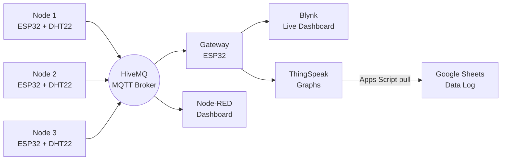

# esp32-wireless-sensor-mesh<div align="center">

# 📡 ESP32 Wireless Sensor Mesh Architecture

**Multi-node IoT monitoring with MQTT, Blynk, ThingSpeak, Google Sheets and Node-RED**


</div>

---

## 📖 Overview

A **wireless sensor mesh** is a network where sensor nodes relay their data toward a gateway instead of every device talking to the cloud on its own. This makes the network more reliable and extends its coverage.

This project builds that architecture with **three ESP32 sensor nodes** (each with a DHT22 temperature and humidity sensor) that publish readings over **MQTT (HiveMQ)** to a **gateway ESP32**. The gateway forwards the data to **Blynk** and **ThingSpeak**, **Google Sheets** logs it automatically, and **Node-RED** shows a local dashboard.

Everything was built and tested in the **Wokwi simulator**, so no physical hardware is needed.

## ✨ Features

- 🌡️ Three sensor nodes reading temperature and humidity (DHT22)
- 🔀 Node to gateway communication over MQTT (publish / subscribe)
- 📲 Live gauges on the **Blynk** dashboard
- 📈 Historical graphs on **ThingSpeak** (6 fields)
- 📊 Automatic data log in **Google Sheets** (Apps Script)
- 🖥️ Local dashboard with **Node-RED**
- 🧪 Fully simulated, no hardware required

## 🏗️ System Architecture



## 🔄 How It Works

1. Each **node** reads temperature and humidity every 5 seconds and publishes `temperature,humidity` to its own MQTT topic.
2. The **gateway** subscribes to all node topics and stores the latest reading of each node.
3. Every 16 seconds the gateway uploads the readings to **Blynk** and **ThingSpeak**.
4. A **Google Apps Script** pulls the latest ThingSpeak entry into **Google Sheets** every minute.
5. **Node-RED** subscribes to the same MQTT topics and displays the values on gauges.

### MQTT topics

| Topic | Payload | Example |
|---|---|---|
| `wsm_mesh/node1` | `temperature,humidity` | `26.7,39.5` |
| `wsm_mesh/node2` | `temperature,humidity` | `24.0,40.0` |
| `wsm_mesh/node3` | `temperature,humidity` | `28.1,55.2` |

> Use your own unique prefix instead of `wsm_mesh`, because the public HiveMQ broker is shared.

### Data mapping

| Node | Blynk pins | ThingSpeak fields |
|---|---|---|
| Node 1 | V0 (temp), V1 (hum) | Field 1, Field 2 |
| Node 2 | V2 (temp), V3 (hum) | Field 3, Field 4 |
| Node 3 | V4 (temp), V5 (hum) | Field 5, Field 6 |

## 🧰 Tech Stack

| Category | Tools |
|---|---|
| Microcontroller | ESP32 DevKit V1 |
| Sensor | DHT22 |
| Simulator | Wokwi |
| Language | Arduino C++ |
| Messaging | MQTT (HiveMQ public broker) |
| Dashboards | Blynk IoT, ThingSpeak, Node-RED |
| Data log | Google Sheets + Apps Script |
| Libraries | `DHT sensor library`, `PubSubClient`, `ThingSpeak`, `Blynk` |

## 📁 Project Structure

```
esp32-wireless-sensor-mesh/
├── README.md
├── node/
│   └── node.ino                  # sensor node code (Node 1, 2, 3)
├── gateway/
│   └── gateway.ino               # gateway code
├── google-apps-script/
│   └── pull_from_thingspeak.gs   # Sheets data pull
├── nodered/
│   └── flow.json                 # Node-RED flow export
└── screenshots/
```

## 🔌 Circuit (per node)

| DHT22 pin | ESP32 pin |
|---|---|
| VCC | 3V3 |
| GND | GND |
| DATA (SDA) | GPIO 4 |

## 🚀 Getting Started

### 1. Create the cloud accounts
- **Blynk:** create a template with 6 double datastreams (`V0` to `V5`) and a device, then note the Template ID and Auth Token.
- **ThingSpeak:** create a channel with 6 fields, then note the Channel ID and the Write and Read API keys.
- **Google Sheets:** create a sheet and add the Apps Script from `google-apps-script/`, then add a time-driven trigger (every minute).

### 2. Run the nodes
1. Create **3 separate Wokwi projects** (ESP32 + DHT22).
2. Paste `node/node.ino` in each and change only these two lines:
   ```cpp
   const char* NODE_NAME = "node1";            // node2, node3
   const char* TOPIC     = "wsm_mesh/node1";   // wsm_mesh/node2, wsm_mesh/node3
   ```
3. Add `DHT sensor library` and `PubSubClient` to `libraries.txt`, then press **Play**.

### 3. Run the gateway
1. Create a 4th Wokwi project and paste `gateway/gateway.ino`.
2. Add `PubSubClient`, `ThingSpeak` and `Blynk` to `libraries.txt`.
3. Replace the placeholders with your own credentials:
   ```cpp
   #define BLYNK_TEMPLATE_ID   "YOUR_TEMPLATE_ID"
   #define BLYNK_AUTH_TOKEN    "YOUR_BLYNK_TOKEN"
   unsigned long channelID = 0;                  // your ThingSpeak channel ID
   const char* thingSpeakAPIKey = "YOUR_WRITE_KEY";
   ```
4. Press **Play** while all three nodes are running.

### 4. (Optional) Node-RED dashboard
1. Install Node-RED and the `node-red-dashboard` palette.
2. Import `nodered/flow.json`.
3. Deploy and open `http://localhost:1880/ui`.

## 🖥️ Sample Output

**Gateway serial monitor**
```
Received [wsm_mesh/node1]: 26.7 C, 39.5 %
Received [wsm_mesh/node2]: 24.0 C, 40.0 %
---- Uploading ----
Blynk: sent
ThingSpeak: 200
```

## 📸 Screenshots

| Serial Monitor | HiveMQ Web Client |
|---|---|
|  |  |

| Blynk Dashboard | ThingSpeak Charts |
|---|---|
|  |  |

| Google Sheets | Node-RED Dashboard |
|---|---|
|  |  |

## ⚠️ Limitations

- Wokwi cannot run real mesh protocols such as ESP-NOW or painlessMesh, so the mesh is **simulated with MQTT** through a broker.
- Wokwi could not make a direct HTTPS call from the ESP32 to Google Apps Script, so Google Sheets **pulls the data from ThingSpeak** instead.
- ThingSpeak's free tier accepts one update every 15 seconds.
- The public HiveMQ broker is open to everyone, so use a unique topic prefix.

## 🔮 Future Improvements

- Real multi-hop mesh using **ESP-NOW** or **painlessMesh** on physical hardware
- Secure MQTT with TLS and username/password authentication
- Alerts and threshold-based notifications
- More sensor types (soil moisture, gas, light)
- Battery-powered nodes with deep sleep

## 🔐 Security Note

No real credentials are stored in this repository. Replace all `YOUR_...` placeholders with your own keys, and never commit tokens, API keys or script URLs.

## 👤 Author

**Navii**
Final-year B.E. Electronics and Communication Engineering student, interested in embedded systems and IoT.

[GitHub](https://github.com/YOUR_USERNAME) · [LinkedIn](https://www.linkedin.com/in/YOUR_PROFILE)

---

<div align="center">

⭐ If you found this project useful, please give it a star!

</div>
